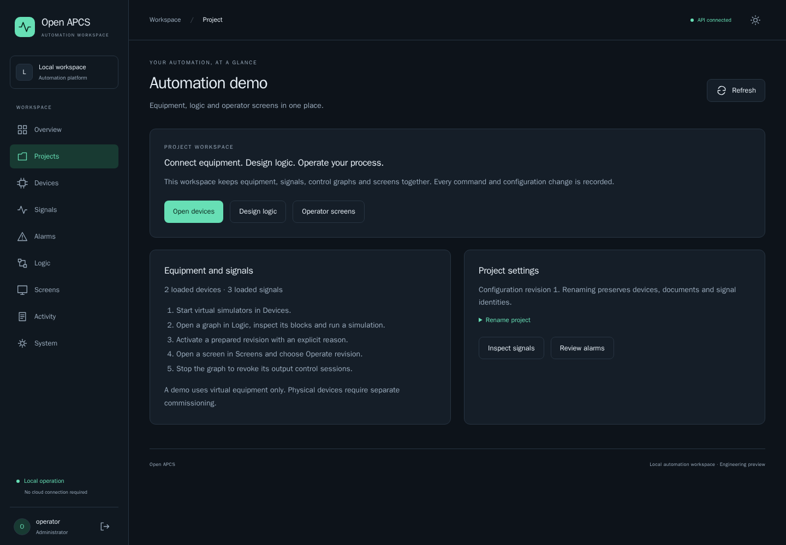
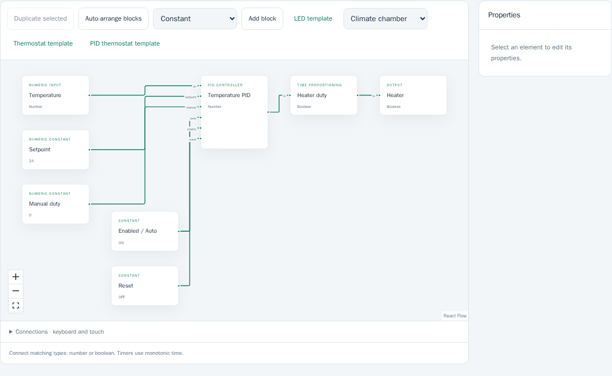
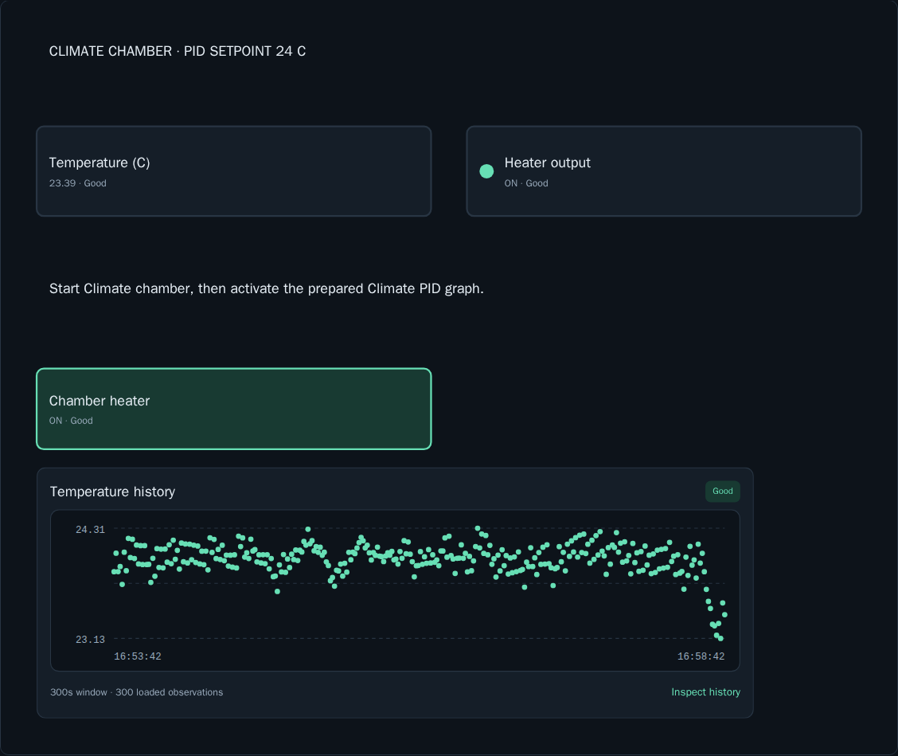

# Open APCS — Local SCADA, HMI & ESP32 Automation

Build control logic, design operator screens and follow your process from a browser. **Open APCS** is a local automation workspace for Linux and Docker, with visual editors, virtual devices and an ESP32 LED integration you can test on real hardware.

The core runs without a cloud account. Start with the included virtual demo, then connect supported equipment when you are ready. Optional OpenAI assistance helps draft logic and screens; normal operation does not depend on it.



**[Quick start](#run-with-docker) · [Try the demo](#try-the-automation-demo) · [Documentation](#documentation) · [Roadmap](docs/roadmap.md)**

## From a signal to an operator screen

- **Project workspaces:** clickable project navigation, persistent context, scoped device and signal catalogs, search and revision-checked naming.
- **Visual control logic:** typed connections, boolean and numeric blocks, timers, hysteresis, PID, weekly schedules and timed sequences. Duplicate, arrange, undo, simulate, compare revisions and deliberately activate prepared logic.
- **HMI screen editor:** arrange labels, groups, values, status indicators, controls and archive trends. Prepared screens show current data quality and use the audited command workflow.
- **Devices and simulation:** a virtual LED and thermal chamber for development; an ESP32 MQTT/TLS LED profile with watchdog and explicit commissioning. Closing the browser does not stop server execution.
- **History, alarms and reports:** raw trends and CSV, minute/hour aggregates, threshold and quality alarms, acknowledgement/suppression, optional SMTP/webhooks, and daily/monthly PDF/CSV reports.
- **AI-assisted drafts:** optional OpenAI with a configurable model, selected signal context, validation and preview. Applying a proposal changes an unsaved draft; it never activates equipment.
- **A responsive workspace:** English interface, light/dark themes, desktop editors and phone-friendly monitoring and controls.





[See the phone operator view](docs/screenshots/operator-phone.png).

## Run with Docker

Requirements: Linux x86-64, Docker Engine with Compose, Git and Make. Initial image/dependency downloads require internet access. For disconnected installation, prepare an [offline engineering bundle](docs/distribution.md) first. The current distribution is an engineering preview, not a hardened production appliance.

```bash
git clone https://github.com/khurss/open-apcs.git
cd open-apcs
make image
make install-dev
make dev
```

Open **http://localhost:5173**. Create your first operator account from another terminal:

```bash
read -rsp 'Administrator password: ' APCS_BOOTSTRAP_INPUT
printf '\n'
printf '%s' "$APCS_BOOTSTRAP_INPUT" | docker compose exec -T api pnpm --filter @open-apcs/api exec tsx src/admin.ts operator
unset APCS_BOOTSTRAP_INPUT
```

Sign in as `operator` with the password you chose (12–256 characters). **There is no default password.** Bootstrap runs only against a database without accounts. Configuration and history persist in Docker volumes; `make dev-stop` stops the stack without deleting them.

For another computer, tablet or phone, configure the [HTTPS LAN profile](docs/lan-testing.md). The development web server is intended for a trusted test network.

## Try the automation demo

1. Open **Projects → Open demo project**. The installer creates a virtual LED, a thermal chamber, prepared LED/PID graphs and operator screens. Reopening it preserves your edits.
2. Open **Devices** and start **Climate chamber**.
3. Open **Logic → Climate PID**, enter an activation reason and activate its prepared revision in the execution panel. This explicitly starts the virtual control loop.
4. Open **Screens → Climate overview → Operate revision 1**. Watch temperature, heater state, quality and the trend; inspect the underlying signal history when needed.
5. Stop the active graph from its execution panel when finished. Equipment starts stopped after an API restart and needs deliberate reactivation.

The demo uses virtual equipment. No ESP32, external account or API key is required. The LED example is a separate small path for trying manual commands and output ownership. See the [project workspace guide](docs/project-workspace.md).

## Optional AI authoring

Configure a private server-side OpenAI key and model using the [AI setup guide](docs/ai-authoring.md). In a saved graph or screen draft, open **AI assistant**, describe the result and review the signal context before sending it.

Proposals pass the same document and binding validation as manually authored content. Review, apply, simulate and save through separate actions. API usage may incur provider charges. Local-model support is planned.

## Develop with hot reload and Docker TDD

The web app uses Vite HMR; the API watches mounted source. Ordinary source edits do not rebuild images.

```bash
make install       # Test dependencies in an isolated Docker volume
make test          # Full Docker gate, including Chromium and firmware checks
make watch         # Unit tests on source changes
# Or: make watch-integration
```

The full gate includes TypeScript, unit/integration tests, browser scenarios, native firmware tests, ESP32 cross-compilation, offline dependency checks and database backup/restore. USB hardware and oscilloscope tests are separate opt-in workflows. See [development](docs/development.md), [test evidence](docs/tdd-log.md) and [browser acceptance](docs/product-acceptance.md).

## Architecture and current scope

| Layer | Implementation |
| --- | --- |
| Web workspace | TypeScript, React, Vite, React Flow, SVG HMI |
| Local API and services | TypeScript, Node.js, Fastify; private runtime, script and report workers |
| Persistence | PostgreSQL configuration, versions, command journal, audit and historian |
| Device transport | MQTT and an explicit MQTT/TLS ESP32 LED profile |
| Firmware | C with ESP-IDF; portable protocol core and watchdog checks |
| Development and deployment | Docker Compose, mounted source, offline engineering bundle |

The [code map](docs/code-structure.md) explains the application, domain and worker boundaries. The repository contains working software and a broader specification. **Not every target requirement is implemented.** Current engineering limits and measured results are documented rather than inferred from the architecture.

| Available now | Planned or not yet qualified |
| --- | --- |
| Virtual LED/thermal process and ESP32 LED bench | General Arduino/AVR, STM32 and other board profiles |
| MQTT integration and local HTTP API | Additional industrial protocols and driver SDK distribution |
| Visual logic, bounded JS/TS blocks, timed sequences and thermal recipe simulation | Full SFC, Structured Text, advanced recipes |
| Explicit revision switching, local restart and backup/restore | High availability, multi-user collaboration and complete production distribution |
| Measured 16-device command/history workload | 10,000-device target qualification |

This is ordinary automation and supervision software. Emergency stops and critical protective functions must remain independent; no SIL certification is claimed. See [safety boundaries](docs/specification.md) and [load qualification](docs/load-l0.md).

### Thermal recipe preview

Open **Recipes**, select a project and choose **Install MQTT recipe demo** for a
configured virtual chamber, Heat → Hold → Cool recipe and operator screen with a
temperature chart. Start its simulator, then run the published recipe. Watch its
current step in **Screens → Recipe chamber overview → Operate revision 1**.
Commands are journaled; completion requires verified OFF. Connection failures
abort without automatic restart. An isolated thermal model is also available.
Physical recipe control remains unavailable. See [recipe scope and limits](docs/recipes.md).

## Documentation

| Guide | What it covers |
| --- | --- |
| [Specification](docs/specification.md) | Product requirements and scope |
| [Architecture](docs/architecture.md) | Runtime, data and command contracts |
| [Editors](docs/editors.md) / [editor tools and trends](docs/editor-tools.md) | Drafts, simulation, versions and HMI |
| [Firmware](docs/firmware.md) / [commissioning](docs/physical-commissioning.md) | ESP32 setup and explicit activation |
| [History](docs/history.md) / [alarms](docs/alarms.md) / [reports](docs/reports.md) | Observation, events and exports |
| [Offline distribution and recovery](docs/distribution.md) | Bundles and backup/restore |
| [Roadmap](docs/roadmap.md) | Delivered increments and future work |
| [Contributing](AGENTS.md) | English repository content, Docker TDD and phase gates |

## Project status and license

Open APCS is developed publicly at [khurss/open-apcs](https://github.com/khurss/open-apcs). An open-source release is intended, but **the license has not yet been selected**. Do not assume MIT, Apache or another license applies.
