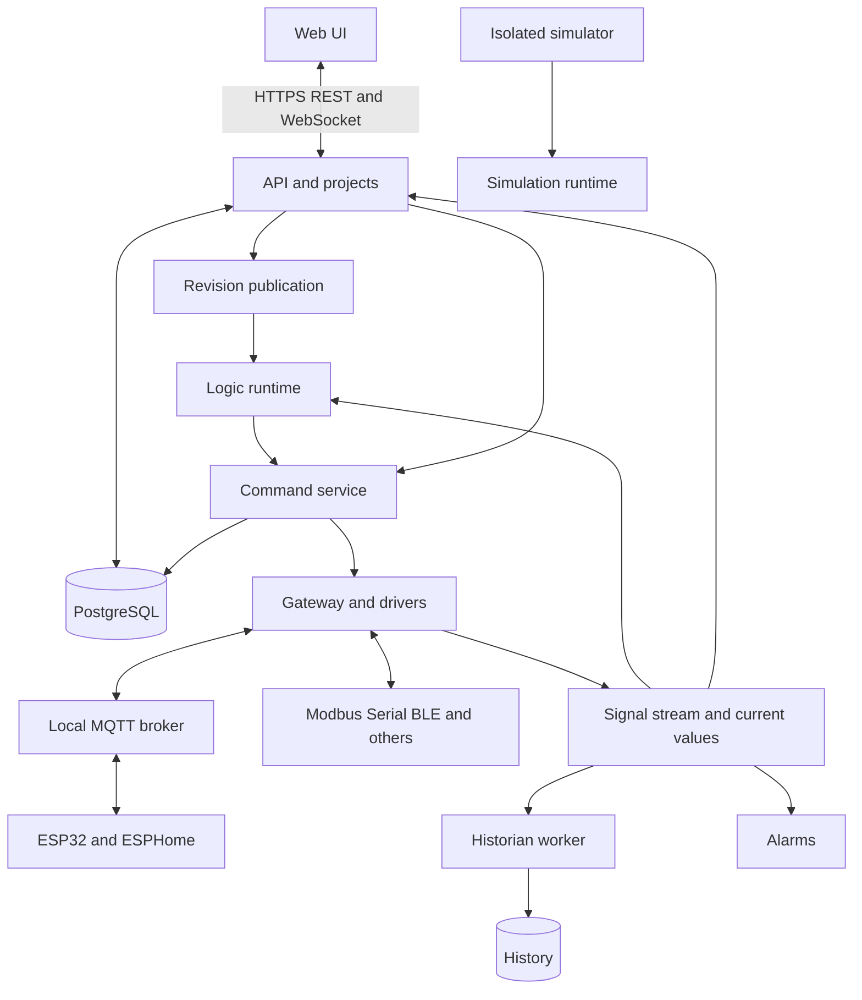
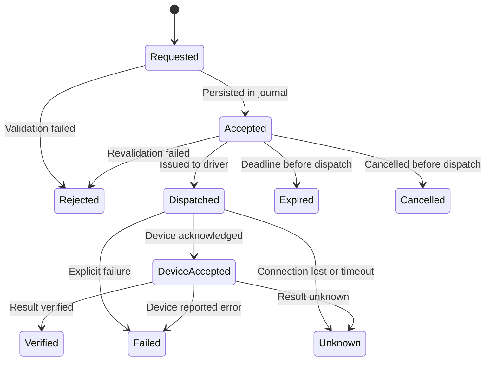

# Open APCS architecture and contracts

Design proposal accompanying the [specification](specification.md). TypeScript, Linux/Docker, local operation, and server-side logic execution are customer requirements. Libraries and numeric settings below are recommended defaults unless marked approved in the decision register.

## 1. Technology stack

| Layer | Proposal | Rationale and limitation |
|---|---|---|
| Frontend | Strict TypeScript, React, Vite | SPA with locally served assets; operator application does not require SSR |
| Interface | Semantic React components, CSS design tokens, local icons | Both themes, touch/keyboard operation, no cloud dependency |
| Graphs | React Flow with a separate domain model | Graph interaction, not execution semantics; [project](https://reactflow.dev/) |
| HMI | SVG scene model + React; canvas only if justified by measurements | Vector symbols, bindings, editing; transport format independent of UI |
| Text | Monaco Editor with locally bundled workers | JS/TS, SDK types, diagnostics, no external CDN |
| API | Node.js LTS + Fastify, TypeScript | Shared domain model and validation; [TypeScript support](https://fastify.dev/docs/latest/Reference/TypeScript/) |
| Runtime and gateways | Node.js, separate processes/workers, TypeScript | Isolation from API/browser, workload separation; not hard real-time |
| Contracts | JSON Schema, TypeBox/Ajv, OpenAPI; JSON external API | Shared schema source and runtime input validation |
| Configuration, commands, audit | PostgreSQL | Transactions, revisions, command delivery journal, migrations |
| History | Initially PostgreSQL time partitions; Historian interface | Full-scale backend selected by load measurements; ClickHouse is a candidate |
| Devices | Local Eclipse Mosquitto, MQTT 5 with 3.1.1 compatibility | Independent local broker; device profiles declare limits |
| Firmware | ESP-IDF C/C++ for custom ESP32 firmware; ESPHome integration | Local watchdog, GPIO, OTA; TypeScript is not imposed on MCUs |
| Tests | Vitest, Testing Library, fast-check, Playwright, Docker Compose | Unit, property, integration, E2E, fault, load; same local and CI interface |
| Repository | pnpm workspace with shared TypeScript settings/schemas | Package boundaries without premature microservices |

At specification preparation, Node.js 24 is in Active LTS; pin its patch version and image digest when building the environment. Follow the [official schedule](https://github.com/nodejs/Release) for upgrades rather than a floating `latest` tag. Lock dependencies; include images, board SDKs, and toolchains in the delivery manifest.

## 2. Components and boundaries



The first deployment is a modular backend from one repository, with a separate runtime process and driver workers. The shared core does not require Kubernetes, Kafka, Redis, or a service for every entity. PostgreSQL and MQTT run in separate containers. A gateway can later run separately with its locally published configuration.

For the agreed 4 CPU / 16 GB / 100 GB SSD / x86-64 host, start with one Linux server and these logical boundaries. In M4, an autonomous gateway gains a local runtime, latest validated manifest, and persistent command/audit journal and telemetry buffer. Operation during a central-server outage must not depend on the central database. Select its local store, such as SQLite for a small gateway, through a separate ADR and contract tests. The initial delivery does not promise HA or a standby executor.

On one server, normalized events use a versioned IPC/RPC contract with bounded queues; not every sample creates a separate PostgreSQL transaction. Remote gateways use an authenticated channel with the same schemas and a configuration-acknowledgement journal. Assign a whole graph to one runtime; arbitrary distribution of its nodes across servers is outside the baseline.

Separate high-rate values, durable command journals, events/alarms, and configuration revisions. Slow history writes must not block control. Bound queues and report lost sequence ranges when data is dropped.

## 3. Domain model

| Entity | Main fields |
|---|---|
| Project | id, name, schemaVersion, draftRevision, activeRevision |
| Site / Asset | id, projectId, parentId, name, kind, metadata |
| Gateway | id, siteId, runtimeId, capabilities, version, health |
| Connection | id, gatewayId, protocol, endpoint, secretRef, options |
| Device | id, assetId, connectionId, profileId/version, address, capabilities, status |
| SignalDefinition | id, deviceId, path, dataType, direction, unit, transform, freshness, archivePolicy |
| SignalSample | signalId, value, quality, sourceTime, receivedTime, clockQuality, origin, bootId, sequence |
| Screen / Symbol | id, schemaVersion, scene, bindings, actions, resources |
| LogicGraph | id, version, nodes, edges, task, stateSchema, outputOwnership |
| BlockDefinition | type, version, input/output schemas, configSchema, stateSchema, resourceLimits |
| AlarmDefinition / AlarmInstance | condition, priority, delays, lifecycle, acknowledgement |
| Command | id, target, action, value, actor, reason, deadline, revision, idempotencyKey, state |
| Recipe / Schedule | version, parameters/actions, transition policy / timezone and calendar policy |
| AuditEvent | id, actor, action, resource, before/after refs, time, outcome, correlationId |
| Deployment | revision, runtimeId, checksum, state, health, activatedAt |

Signal UUIDs do not encode equipment addresses. Protocol addresses belong to driver mappings. Project JSON contains only references to a local secret store, never the secrets themselves.

API time uses UTC RFC 3339; display timezone is separate. Timers use monotonic time. `sourceTime` may be `null`; do not substitute server time for unknown device time without marking its origin. A late historical record must not replace a newer current value.

Example normalized sample, with illustrative identifiers:

```json
{
  "schemaVersion": 1,
  "signalId": "7f3d45a0-4a9d-42c3-a71c-3c2d64ca1001",
  "value": true,
  "quality": "Good",
  "sourceTime": null,
  "receivedTime": "2026-10-12T12:00:00.000Z",
  "clockQuality": "receiver-only",
  "origin": "device",
  "bootId": "boot-42",
  "sequence": 123
}
```

## 4. Logic scheduler

Recommended initial profiles:

| Task | Setting | Limitation |
|---|---|---|
| Ordinary telemetry | Push on change; periodic snapshot every 1 s | Sensor sampling and transmission rates are configured separately |
| Modbus polling | Initial 1 s period for an agreed register set | Scheduler validates each line's bandwidth |
| Logic reactions | On input change; coalesce ordinary state updates within up to 50 ms | Do not lose discrete edges/counter events through coalescing |
| Slow automation | Periodic 1 s task | Measure actual jitter |
| Timers and ordinary PID | Proposed 100 ms period for suitable slow processes | Requires sufficiently frequent inputs and measured bench latency |
| Fast control loop | External controller/local specialized function | Node.js runtime does not promise periods below 100 ms or hard deadlines |
| Operator screen | 250 ms update batches, typically displayed at 1 Hz | Visible/subscribed signals only; alarms and commands travel separately |
| History | On change plus a default 60 s checkpoint | Per-signal interval and deadband overrides |

These are starting engineering settings, not universally prescribed frequencies. Executing a PID ten times per second does not create new measurements from a sensor sampled once per second; validation warns about mismatches. Choose each process's period from its dynamics and acceptable delay.

One task cycle:

1. Read a consistent value/quality snapshot as of cycle start.
2. Calculate the acyclic portion in stable topological order. Stateful blocks read previous state and commit next state after calculation.
3. Process edges/events in `(ingestSequence, sourceId)` order without claiming a global physical-event order across independent clocks.
4. Produce new values, events, and command intents.
5. Submit intents to the command service and publish results/cycle metrics.

Pure computation performs no I/O. Drivers receive commands asynchronously. A graph's next cycle cannot overlap its previous cycle. Budget overruns cause diagnostics; missed cycles are not replayed in a catch-up burst that repeats output pulses.

Each block state has a version and `volatile`/`retained` policy. Retained state defines checkpoints and acceptable crash loss. Critical counters use acknowledged persistence or device readings. Incompatible state migration requires stopping the selected graph and explicit initialization.

Per-graph publication: validate the dependency closure → prepare the new version without I/O → validate state migration and output ownership → atomically replace the active graph/version in the manifest at a cycle boundary. Other graphs continue. Reject old-generation intents after switching; transfer state only through declared migrations. Changes to shared signals/blocks expand the deployment scope, shown before activation. An incomplete switch keeps the previous manifest; rollback after issued commands does not automatically undo physical actions.

## 5. Scripts and extensions

Compile TypeScript to JavaScript in a local build worker. Run user code in a separate restricted process/container under a separate UID with a read-only filesystem, no network/secrets, and limits on CPU, memory, duration, and result size. Signal access and commands go through a narrow RPC contract. `node:vm` alone is not a security boundary, as stated in the [Node.js documentation](https://nodejs.org/api/vm.html).

Initial proposed per-invocation limits: 50 ms wall time, 64 MiB memory, and 256 KiB result, configurable per deployment. Exceeding a limit fails the invocation and discards its result. Test enforcement in the selected isolation implementation; configuration fields alone do not establish guarantees.

Drivers receive explicit permissions for endpoints, serial devices, or radio adapters. Package installation must not execute arbitrary lifecycle scripts with host Docker socket access. The runtime must not import unsigned/unverified project JavaScript into its own process.

## 6. Command contract



`Verified` must identify evidence: firmware-reported output, register readback, or independent mechanism feedback. Without an application ACK, `Dispatched → Verified` is allowed only with configured successful readback; otherwise the result stays unconfirmed. Close `Unknown` through a reconciliation record preserving the original uncertainty in history.

Rules:

- A `POST` with the same actor-scoped `Idempotency-Key` and payload returns the same command ID; a different payload with that key is a conflict.
- Validate on acceptance and immediately before dispatch: protections or mode may change while waiting.
- Each output has one active owner. Manual override explicitly transfers ownership with a reason and expiry; it does not bypass protection.
- Prefer state commands such as `set true/false` over `toggle`. Pulses have bounded duration and terminate locally on the device.
- Exactly-once physical actions cannot be guaranteed for arbitrary equipment. A crash after transmission but before ACK persistence may leave the result unknown.
- Accepted-command and outbox records share one transaction. After restart, workers check deadline, state, and retry policy; blind replay is prohibited.
- The initial PostgreSQL journal allows at most one unfinished command per output. Unknown occupies it until explicit reconciliation. See the [journal contract](command-journal.md) for implemented rules and limits; it does not imply a completed dispatcher/API.
- Custom ESP32 firmware validates command ID, session/boot ID, control-session validity, and deadline. A duplicate within the current session returns the prior result. Reboot changes the session and rejects old commands.
- TTL alone is insufficient if it starts only after delayed-message reception. The protocol requires an established time/monotonic-offset estimate with bounded error or verified session freshness. Prohibit hazardous writes when age cannot be verified.
- MQTT control topics use `retain=false`; old commands must not be delivered on reconnect. QoS does not replace application acknowledgement or deduplication. See [MQTT 5](https://docs.oasis-open.org/mqtt/mqtt/v5.0/mqtt-v5.0.html).

A device heartbeat proves availability; a separate control lease from the active runtime authorizes holding an output. A working broker or ongoing telemetry does not renew that lease. If the command journal is unavailable, the demo runtime stops renewing the lease and lets firmware switch OFF on timeout. Other policies require an explicit process-specific decision.

Example HTTP request:

```json
{
  "targetSignalId": "7f3d45a0-4a9d-42c3-a71c-3c2d64ca1001",
  "action": "set",
  "value": true,
  "ttlMs": 3000,
  "expectedProjectRevision": 12,
  "reason": "LED commissioning"
}
```

The user does not supply a trusted `actorId`; the backend derives it from the session. The server bounds TTL by output policy and returns `202 Accepted` with the command ID, not a claim that equipment was successfully activated.

## 7. Failure behavior

| Event | Required behavior |
|---|---|
| Browser closed | Runtime/devices continue; an open tab is not a watchdog |
| API restarted | Separate runtime continues assigned tasks; new user commands wait for API readiness |
| Runtime stopped | Control lease expires; local firmware applies the configured output state |
| MQTT/network lost | Signal quality degrades; commands do not queue for execution after recovery |
| Device rebooted | Safe boot state, new session, configuration reconciliation, no replay of previous commands |
| PostgreSQL unavailable | Reject new commands requiring durable audit; apply the chosen current-control policy and local protections |
| Historian unavailable | Bounded disk buffer; explicit loss event on overflow; no blocked control cycle |
| Disk full | Reserve diagnostics space, stop noncritical writes, prohibit new control operations if audit is impossible |
| Invalid revision | Runtime retains the last working configuration |
| Overload or stalled script | Limit/stop the responsible task and apply its output policy; isolate other tasks |
| Connectivity restored | New session and snapshot, state reconciliation, control enabled according to restart policy |

Proposed LED-bench defaults: 1 s heartbeat, OFF after 3 s without a valid control lease, `Stale` after 3 s without a sample, no automatic reactivation. These values apply only to the bench; the UI must not present them as universally safe industrial-process settings.

## 8. API and update streams

Prefix: `/api/v1`. REST handles configuration, history, and commands; WebSocket carries current values/events. HTTP errors contain `code`, `message`, `details`, and `correlationId`. Lists use cursor pagination, filters, and limits. `ETag`/`If-Match` prevent overwriting newer configuration.

| Endpoint | Purpose |
|---|---|
| `POST /auth/login`, `POST /auth/logout`, `GET /auth/me` | Local session |
| `GET/POST /projects`, `GET/PATCH /projects/{id}` | Projects |
| `GET/POST /devices`, `GET/PATCH /devices/{id}` | Devices and profiles |
| `GET/POST /signals`, `GET /signals/{id}/value` | Definitions and current state |
| `GET/PUT /screens/{id}`, `GET/PUT /graphs/{id}` | Editor drafts |
| `POST /projects/{id}/validate` | Validation with paths to invalid nodes/ports |
| `POST /projects/{id}/revisions` | Create immutable revision |
| `POST /deployments`, `GET /deployments/{id}` | Activation and status |
| `POST /commands`, `GET /commands/{id}` | Control and outcomes |
| `GET /alarms`, `POST /alarms/{id}/acknowledge` | Alarms and acknowledgement |
| `GET /history`, `POST /history/exports` | History and asynchronous export |
| `POST /simulations`, `POST /simulations/{id}/inputs` | Simulation |
| `GET /audit`, `GET /health/live`, `GET /health/ready` | Audit and readiness |
| `POST /firmware/jobs`, `GET /firmware/jobs/{id}` | Validate, build, flash/OTA |
| `GET /stream` | WebSocket subscriptions |

WebSocket: `subscribe` → snapshot with revision/cursor → ordered changes → heartbeat. After disconnection, clients send their cursor; if the replay window expired, the server requires a new snapshot. Command/alarm states are not coalesced. Ordinary values may coalesce to the latest value for UI only, not historical edges or logic.

Limit subscriptions by client, project, and signal count. Slow clients receive resync/disconnect rather than unbounded server queues. Recheck access on subscription and permission changes.

## 9. Storage and load sizing

Target scale: 10,000 devices × 5–10 signals = 50,000–100,000 signals. At one update per signal per second, this is 50,000–100,000 samples/s, or 4.32–8.64 billion/day. Assuming 32 payload bytes per record yields 138–276 GB/day before indexes, WAL, replication, and overhead. This is arithmetic, not a measurement of the chosen database.

Holding 100,000 current values and archiving every value every second are different workloads. On-change recording reduces load only when values actually change less frequently. Analog noise without suitable deadband may provide little reduction.

Initial storage: PostgreSQL batch inserts, time partitions, `(signal_id, time)` indexes, old-partition removal, and worker aggregation; see [PostgreSQL documentation](https://www.postgresql.org/docs/current/ddl-partitioning.html). Benchmark Historian independently at target load; if it fails, introduce a specialized backend while preserving the history API. Configuration and audit remain in PostgreSQL.

Proposed aggregates: 1 min and 1 h, both retained for one year. Audit and alarms default to one year with separate settings; incident capture defaults to 30 days. Late data within the retained raw window recalculates affected minute/hour buckets. Older data requires an explicit import/recalculation rather than silently changing reports. Time-in-state calculations require the value preceding the interval and quality boundaries.

Initial disk budget: proposed history quota 40 GiB, warning at 70%, critical at 85%, reserve at least 10 GiB. Forecast capacity before adding archived signals; a seven-day archive that does not fit fails the requirement. At buffer capacity, limit writes with explicit loss diagnostics; never silently shorten the retention policy.

## 10. Docker and offline distribution

Proposed Compose services: `web`, `api`, `runtime`, `gateway`, `postgres`, `mqtt`, `historian-worker`, `script-runner`, `simulator`; separate `test`, `e2e`, `load`, `firmware`, and `hil` profiles. One application image may serve different process commands.

Containers default to nonprivileged execution, limited capabilities, read-only root filesystems, and named data volumes. Pass only a specific `/dev/...` serial device to gateway/flasher. BLE uses a restricted local service rather than a fully privileged container. Production API/plugins must not mount the Docker socket.

A reverse proxy/web service provides HTTPS with a locally trusted certificate. Accounts, broker ACLs, and certificates remain local; initial administrator creation does not use a shared source-code password. Document local account recovery without cloud access.

The offline bundle includes OCI images with digests, project/schema versions, migrations, documentation, manifest/SBOM, firmware/toolchains, board/library packages, TypeScript dependencies, and test browser binaries. Installation, updates, firmware builds, and local package installation must pass with external egress blocked. Bundle preparation may use an internet-connected machine beforehand. Updates are explicit; automatic remote firmware application is disabled by default.

Backups include the configuration database, history according to policy, projects/resources, broker configuration, firmware manifests, and separately protected secrets. Restoration verification must not automatically enable physical outputs. Define exact RPO/RTO after selecting equipment and data volumes.

Proposed baseline: daily and pre-update backups; 7 daily and 4 weekly copies on separate media. Daily-only copies cannot guarantee RPO below 24 hours without WAL/archive mechanisms. A file on the same SSD does not protect against that SSD failing. Audit is append-only at the application layer, not resistant to a database administrator; that requires separate immutable storage/signed exports.

A local time source, such as LAN NTP or monitored system clocks, must not depend on external internet. Large wall-clock jumps preserve monotonic timers, mark source time uncertain, and trigger control-session/deadline revalidation. Authentication includes cookie/CSRF protection, WebSocket Origin checks, login rate limits, modern password hashing, and no disabling of TLS verification to restore connectivity. HTTP/webhook drivers require an explicit allowlist of local addresses and cannot contact arbitrary administrative endpoints.

## 11. Proposed code structure

```text
apps/web                 Web interface
apps/api                 HTTP and WebSocket
apps/runtime             Scheduler and published graphs
apps/gateway             Driver supervisor
apps/simulator           Virtual devices and processes
apps/script-runner       User-code isolation
packages/contracts       JSON Schema and API types
packages/domain          Signals, commands, alarms, revisions
packages/logic           Blocks and executable model
packages/hmi             Scene, symbols, bindings
packages/driver-sdk      Driver contracts
packages/drivers         Built-in adapters
packages/device-profiles Capabilities and address maps
firmware/esp32-io        Custom firmware
tests/contract           Shared implementation checks
tests/integration        Real services in Docker
tests/e2e                Browser scenarios
tests/fault              Failures and recovery
tests/load               Load profiles
deploy                   Compose and offline manifests
docs                     Specifications and guides
```

This is a structural plan, not a list of completed applications. PostgreSQL migrations, OpenAPI, and detailed JSON Schemas are implemented through TDD in their respective phases; this specification defines their semantic contract. The initial command-journal migration is documented separately in the [journal contract](command-journal.md).
