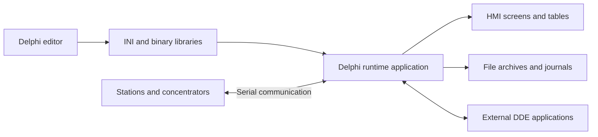

# Analysis of the legacy Bug supervisory control system

Analysis date: October 12, 2026. Method: static inspection of Pascal modules, entry points, and storage formats. Legacy EXE, DLL, and VBX files were not executed; operation on hardware was not verified. An identified implementation establishes the presence of code, not a verified operational characteristic.

The legacy system is a functional reference. By customer decision, importing old projects/archives and supporting old stations are outside the new system's scope. Links below refer to the external local `old-code` study directory, which is not distributed in this repository; they require the original workspace layout.

## Inventory

| Directory | Purpose | Size excluding AppleDouble `._*` files |
|---|---|---|
| `old-code/A_bug_n` | Runtime application: polling, display, commands, archives | 55 Pascal modules, 50,340 lines, 38 DFM files, 359 `.mns` files |
| `old-code/Ed_Asdu` | HMI and configuration editor | 38 Pascal modules, 24,737 lines, 35 DFM files, 2 `.mns` files |

The `.mns` count is not a count of unique working screens: the collection includes libraries and variants. Total: 93 Pascal modules and 75,077 lines, including comments and unused sections.

Entry points: [ASDU_BUG.DPR](../../old-code/A_bug_n/ASDU_BUG.DPR) and [ED_ASDU.DPR](../../old-code/Ed_Asdu/ED_ASDU.DPR). Applications use VCL/Windows APIs, MDI forms, `TTimer`, window messages, `MSComm`/VBX, and DDE. Cross-references use absolute source paths such as `\PIT\...`; these are not independent projects with reproducible modern builds.

## Identified functions and their evolution

| Function | Source evidence | New-system requirement |
|---|---|---|
| Station catalog, channels, repeaters, polling intervals, connection status | [CT_LIST.PAS](../../old-code/A_bug_n/CT_LIST.PAS), `TCTO_Array`, `SetOprosCT`, `SetCommandCT`; editor `CT_OPIS.PAS` | Device, gateway, connection, and profile catalogs; connection diagnostics |
| Analog, discrete, and pulse measurements | [M_LIST.PAS](../../old-code/A_bug_n/M_LIST.PAS), `TMeasu_Array`; [DAN_LIST.PAS](../../old-code/A_bug_n/DAN_LIST.PAS), `TDan_Array` | Typed signals, timestamps, quality, origin |
| Units and scale conversion | [UN_LIST.PAS](../../old-code/A_bug_n/UN_LIST.PAS), `TUn_Array`, `Get_value` | Units, ranges, scaling, calibration |
| Calculated parameters, coefficients, accumulation, reset | [RP_LIST.PAS](../../old-code/A_bug_n/RP_LIST.PAS), `TRp_Array`, `UpDate_Value_ID` | Calculated signals, formulas, counters, integrators, explicit state |
| Thermal engineering formulas | [TEP_TEC.pas](../../old-code/A_bug_n/TEP_TEC.pas), enthalpy, specific volume, boiler characteristics | Industry packages over a generic core; separately verified formulas |
| Editing primitives, blocks, labels, indicators, buttons | [MNSLIST.PAS](../../old-code/A_bug_n/MNSLIST.PAS), `TDrawingTool`, `TMnsArray`; [editor MNS_WIN.PAS](../../old-code/Ed_Asdu/MNS_WIN.PAS) | Web HMI editor: SVG, layers, bindings, groups, undo/redo |
| Symbol library and state display | [TC_LIB.PAS](../../old-code/Ed_Asdu/TC_LIB.PAS), `NUGO_ED.PAS`, `NUGO_LIB.PAS`; runtime `TC_VID.PAS`, `VIZ_LIST.PAS` | Parameterized symbols, faceplates, value/quality-dependent states |
| Navigation through screens, tables, and charts | [CONF_SYS.PAS](../../old-code/Ed_Asdu/CONF_SYS.PAS), `Load_Config_mns`, `Save_config`; `TREE_MNS.PAS` | Site/screen/signal tree and equipment navigation |
| Remote control, command prohibitions, action duration, results | [SET_TU.PAS](../../old-code/A_bug_n/SET_TU.PAS), [MAIN.PAS](../../old-code/A_bug_n/MAIN.PAS), `Send_TU` | Shared command service, permissions, interlocks, expiry, result verification |
| Macro commands | [MAKRO_TU.PAS](../../old-code/Ed_Asdu/MAKRO_TU.PAS), runtime `MAIN.PAS:SetMakro_TU` | Stateful sequences, timeouts, partial-failure handling |
| Scheduled control | [TU_LIST.PAS](../../old-code/A_bug_n/TU_LIST.PAS), `SetTU`, `SetTU_All`; `GRAPH_TU.PAS` | Timezone-aware schedules, missed-event policy, duplicate prevention |
| Event reactions: message, sound, opening a screen, command | [EVN_LIST.PAS](../../old-code/Ed_Asdu/EVN_LIST.PAS), `TEvent_Array`; runtime `MAIN.PAS:ChangeDatEvent` | Events/alarms, acknowledgement, routing, automation through the command service |
| On-change, hourly, and daily archives | `M_LIST.PAS:TMeasu_Array.mode`, [SET_ARKH.PAS](../../old-code/Ed_Asdu/SET_ARKH.PAS), `MAIN.PAS:SaveData`, `Save_DataPrecent` | On-change history, heartbeat records, retention, aggregates |
| Trends, charts, tables, printing | `TREND.PAS`, `DAT_GRAF.PAS`, `MAINGRAP.PAS`, `SET_TABL.PAS`, `VIEW_PRN.PAS`, `PRN_GRAP.PAS` | Interactive trends, comparison, CSV, print/PDF |
| Data capture around an alarm | [Reg_List.pas](../../old-code/A_bug_n/Reg_List.pas), `List_Data`, `xPosle`, `SaveDataAlarm`; `Set_Reg.pas`, `Show_RGa.pas` | Pre-event ring buffer, post-event recording, incident timeline |
| Operator action and connection monitoring | `CONTR_OP.PAS`, `CONTROL.PAS`, `DAN_LIST.PAS:ControlAppl_*`, `MAIN.PAS:Save_DataControl` | Application-immutable audit including user, reason, and result |
| Exchange with other applications | `MAIN.PAS:AsduDdeTopicExecuteMacro`, `SetDataStr`; `V_UROV.PAS`, path settings in `MAINUNIT.PAS` | Versioned HTTP API, update stream, protocol plugins |

## Actual legacy model

Signal addressing depends on numeric ID digits and station types. Lists use `TList`, manual allocation, and linear searches. Configuration and live state frequently share globals in `MAINUNIT.PAS`; model functions access `MainForm`.

Serial communication is explicitly implemented in `MAIN.PAS:OpenPort`, `AnalizRecive_Comm`, and `ChangeRecive_Comm`; settings include 9600/19200 baud, custom buffers, and checksums. `KONCRS.PAS` contains ELSI, TEM-5, BTP02, and CCX decoders. These decoders do not establish Modbus or other modern standard-protocol support.

No general executable graph/FBD/SFC editor was found in the inspected source. Event reactions, formulas, schedules, and macros exist. The new logic editor is a separate product component, not a port of the old HMI editor.

`OTCHET.PAS` and `OTCHETA.PAS` primarily contain form declarations; `OTCH_TBL.PAS` has limited data loading. File names alone therefore do not establish a sophisticated report designer.

## Limitations the new architecture must remove

1. Polling and reactions depend on a windowed application. A separate runtime must continue operating without an open browser.
2. `MNSLIST.PAS:SaveFile/LoadFile` and other lists write structures using `SizeOf(record)`. Formats depend on field layout and legacy types. New projects need documented schemas, versions, and migrations.
3. Devices and their addressing are embedded in the shared model. New signal UUIDs must be independent of protocol addresses and physical ports.
4. `MAINUNIT.PAS:CodePassword` uses reversible XOR encoding, and configuration stores shared role passwords. The new system requires individual local accounts, modern password hashing, and server-side authorization.
5. Window timers, extensive globals, and suppressed `except` blocks impede diagnostics and isolated testing. The new core uses explicit dependencies, virtual clocks, structured errors, and TDD.
6. Sending a command, protocol acceptance, and physical completion must become separate states. Retrying after disconnection must not be assumed safe.
7. Industry calculations and presentation must be separate from generic signals, logic, and devices. Pump, electrical, heating, and other industry symbols are delivered as packages.

## Study limits

This is a functional and architectural analysis of significant subsystems with a source inventory, not a line-by-line audit of all 75,000 lines or validation of old binary formats. Compiler version, external-component completeness, and compatibility with physical stations were not established. They are not dependencies of the new implementation because the customer excluded legacy compatibility.
